# AegisOps AI X

### AI-Assisted Security Operations, Detection Engineering & Business Risk Intelligence

**Python · FastAPI · SQLite · Streamlit · Ollama · LangGraph · Sigma · CISA KEV · scikit-learn · promptfoo · OpenTelemetry · Trivy**

> **Portfolio / educational reference implementation.** This project uses synthetic security events and fictional assets. It is not a production SIEM, an autonomous incident-response system, or a validated threat-classification product.

AegisOps AI X is an integrated security operations prototype that connects **deterministic detection**, **asset-aware risk prioritization**, **vulnerability intelligence**, **experimental machine learning**, and **AI-assisted investigations** in a single analyst-facing application. The goal is to demonstrate how a small security team could organize evidence, prioritize review, and communicate risk to business stakeholders—with explicit safeguards and clear limitations.

**[Quick start](#quick-start) · [Architecture](#architecture) · [Demonstration](#project-demonstration) · [Testing](#testing-and-validation) · [Six-hour build guide](docs/SIX_HOUR_BUILD.md)**

## Project demonstration

### SOC dashboard

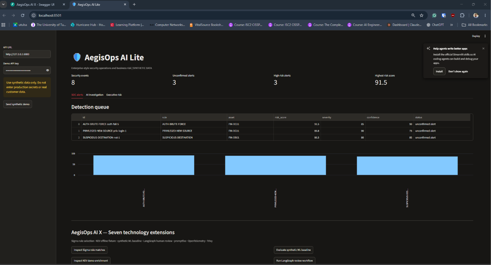

### API documentation and event ingestion

| FastAPI documentation | Synthetic security events |
|---|---|
| 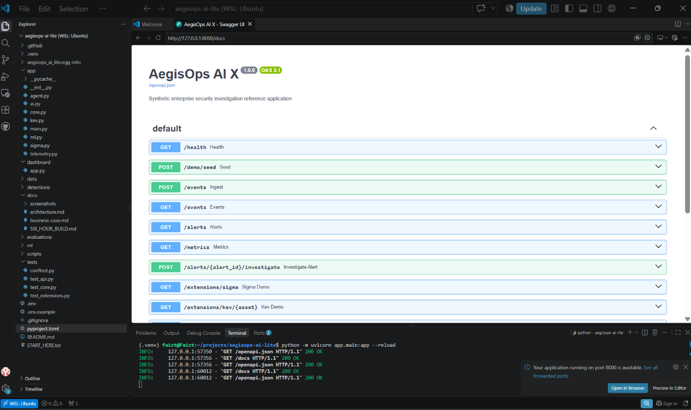 | 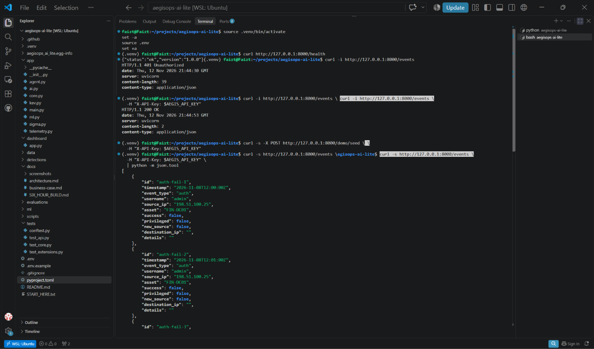 |

### Detection results and AI-assisted investigation

| Detection queue | Investigation output |
|---|---|
| 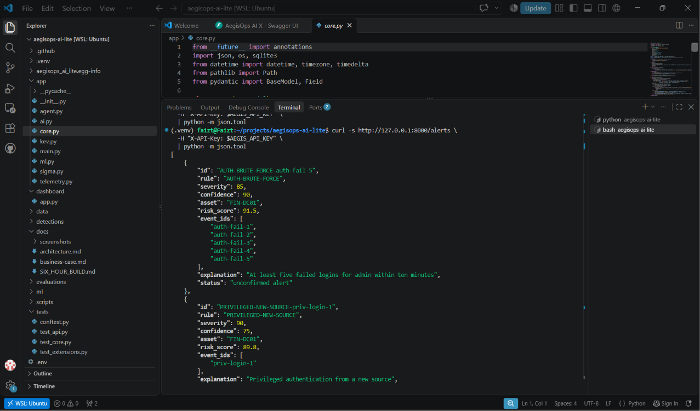 | 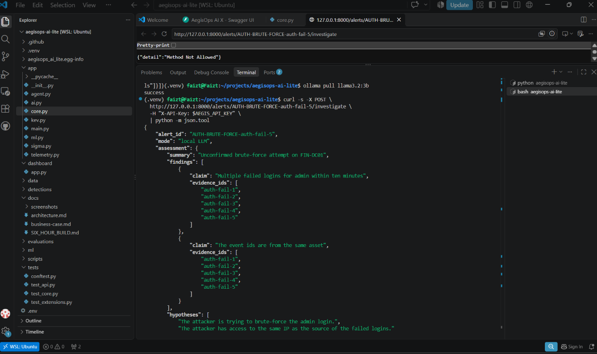 |

### Analyst and executive views

| AI dashboard | Business-risk prioritization |
|---|---|
| 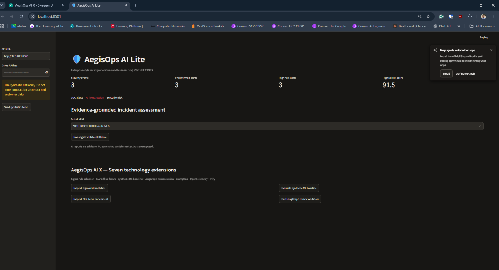 | 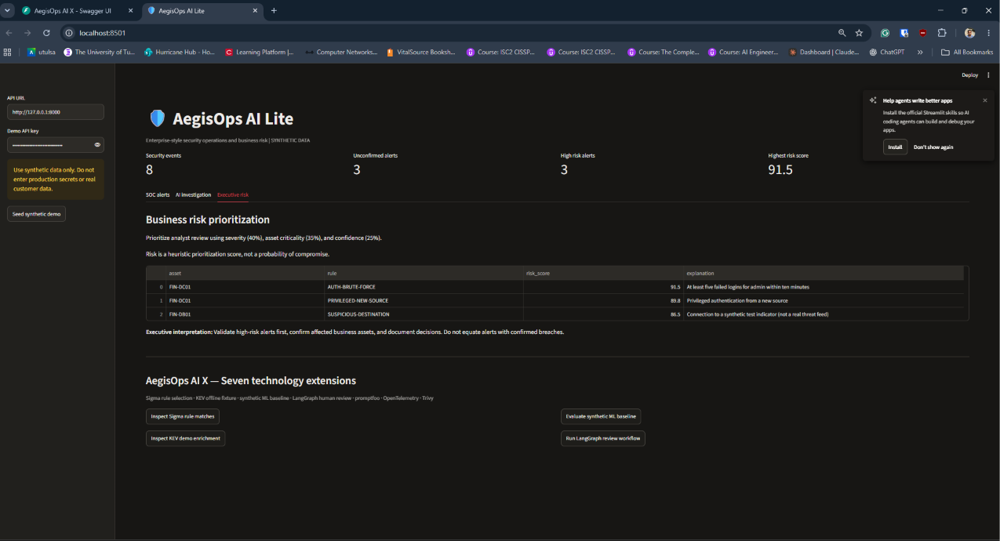 |

### Engineering evidence

| Automated tests | API authorization | GitHub Actions |
|---|---|---|
| 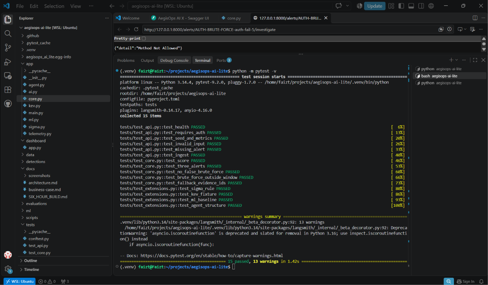 | 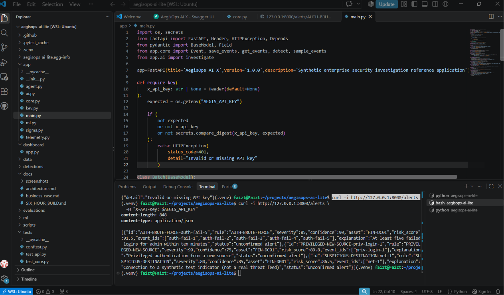 | 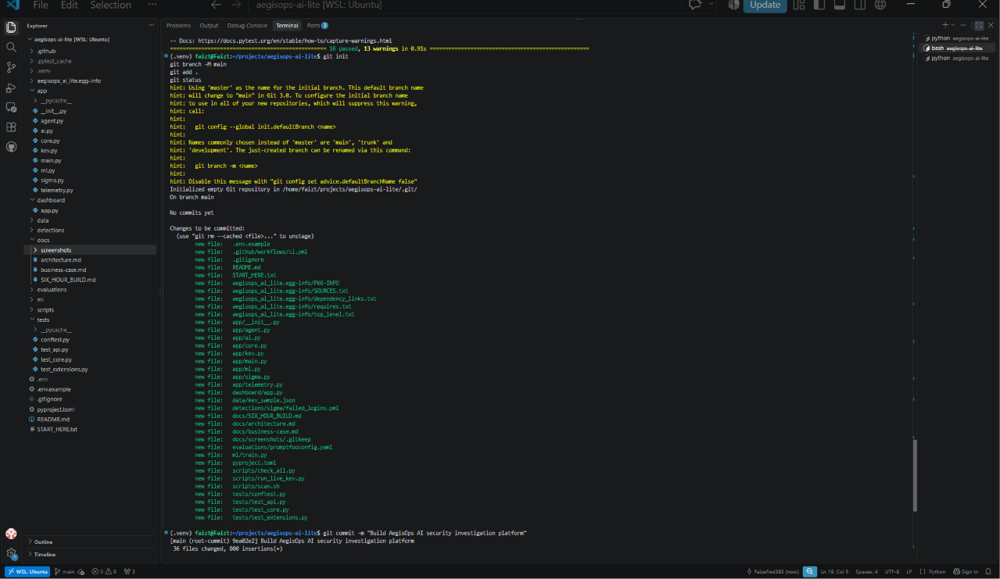 |

> The screenshots above are included in the repository archive. They document development and demonstration sessions; rerun the commands below to verify behavior in your own environment. Additional screenshots and alternate captures are in [`docs/screenshots/`](docs/screenshots/).

## Business problem

**Scenario:** A fictional financial-services organization needs to triage suspicious login and network events, identify which systems matter most, and prepare evidence-based summaries for analysts and management.

**Users:** SOC analysts, detection engineers, security managers, IT operations, and risk/compliance stakeholders.

**Prototype workflow:**

1. Ingest and store validated synthetic events.
2. Run transparent detection rules and identify supporting event IDs.
3. Prioritize unconfirmed alerts using severity, asset criticality, and confidence.
4. Enrich selected assets with a **hypothetical** CVE mapping and CISA KEV context.
5. Run an experimental ML baseline on separate, synthetic rule-generated labels.
6. Draft an AI-assisted investigation from supplied evidence, then flag it for human review.
7. Present analyst findings and business-risk priorities through Streamlit.
8. Validate behavior with tests, prompt-level adversarial checks, tracing, and repository scanning.

## Architecture

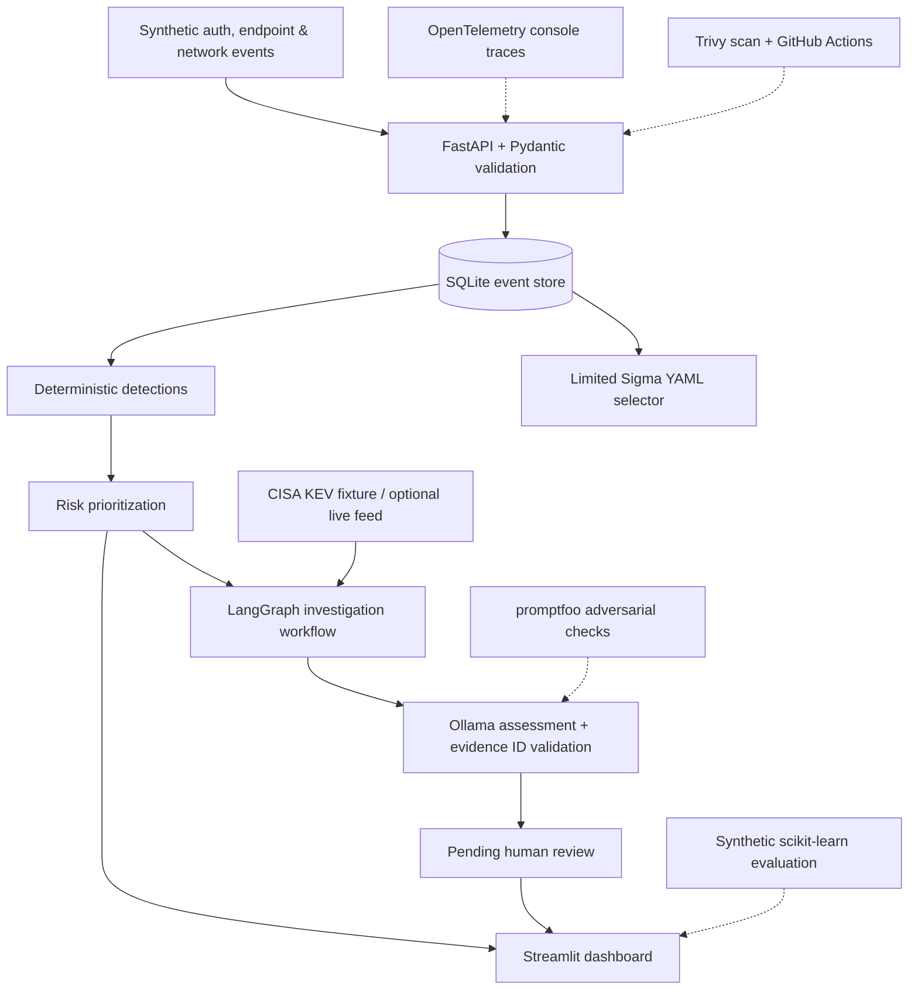

The ML extension is an **independent evaluation/demo endpoint**, not a trained model automatically driving production alert decisions. The Sigma component supports a **limited rule-selection subset**; the main detection engine performs time-window correlation. The LangGraph review gate sets a status only; it does not execute containment or persist an approval.

See [`docs/architecture.md`](docs/architecture.md) for trust boundaries and production gaps.

## Implemented capabilities

| Component | Implementation | Key files |
|---|---|---|
| Event ingestion | Pydantic schema validation, batch ingestion, SQLite storage | `app/main.py`, `app/core.py` |
| Security detections | Brute-force authentication, privileged new-source login, synthetic suspicious destination | `app/core.py` |
| Sigma | YAML rule and deliberately limited matching logic | `detections/sigma/failed_logins.yml`, `app/sigma.py` |
| Business risk | Weighted severity, asset criticality, confidence score | `app/core.py` |
| CISA KEV | Bundled offline fixture; optional live catalog fetch | `app/kev.py`, `data/kev_sample.json` |
| ML | Synthetic-data logistic regression with precision, recall, F1 | `app/ml.py`, `ml/train.py` |
| AI investigation | Local Ollama JSON assessment, Pydantic schema and evidence-ID validation, fallback | `app/ai.py` |
| Agent workflow | LangGraph enrich → investigate → pending human review | `app/agent.py` |
| Dashboard | SOC alerts, AI investigation, executive risk, extension controls | `dashboard/app.py` |
| AI security evaluation | Three prompt-level adversarial smoke tests | `evaluations/promptfooconfig.yaml` |
| Observability | Optional OpenTelemetry console tracing | `app/telemetry.py` |
| DevSecOps | pytest, GitHub Actions, optional Trivy scan | `tests/`, `.github/workflows/ci.yml`, `scripts/scan.sh` |

### Detection logic

| Rule | Trigger | Interpretation |
|---|---|---|
| `AUTH-BRUTE-FORCE` | Five failed logins for an account within ten minutes | Possible password attack; not proof of compromise |
| `PRIVILEGED-NEW-SOURCE` | Privileged successful login flagged as a new source | Investigate authorization and context |
| `SUSPICIOUS-DESTINATION` | Connection to a synthetic indicator | Review endpoint/network evidence |

**Risk-priority formula:** `0.40 × severity + 0.35 × asset criticality + 0.25 × confidence`, with inputs on a 0–100 scale. The score is a **project-defined triage heuristic**, not a probability of compromise or a validated industry risk metric.

## Quick start

### Prerequisites

- Python **3.11+** (Python 3.12 recommended), Git, and a terminal (WSL Ubuntu is supported).
- Ollama and the `llama3.2:3b` model **optional** for local LLM reports. The application has a labeled rules-based fallback.
- Node.js and promptfoo **optional** for prompt-injection evaluations.
- Trivy **optional** for filesystem scanning.

```bash
# Clone your GitHub repository, then enter its root folder:
# git clone <YOUR_REPOSITORY_URL>
# cd AegisOpsAI-Lite

python3 -m venv .venv
source .venv/bin/activate
python -m pip install --upgrade pip
python -m pip install -e '.[dev]'

cp .env.example .env
python -c "import secrets; print(secrets.token_urlsafe(32))"
# Paste the generated secret as AEGIS_API_KEY in .env.

set -a
source .env
set +a

python -m pytest -q
python scripts/check_all.py
```

**Terminal 1 — API:**

```bash
python -m uvicorn app.main:app --reload
```

Open **http://127.0.0.1:8000/docs**.

**Terminal 2 — dashboard:** activate the virtual environment and load `.env` as above, then:

```bash
python -m streamlit run dashboard/app.py
```

Open **http://localhost:8501**, enter the configured demo API key, and select **Seed synthetic demo**.

> Keep the application on localhost. Do not publish the shared API key or expose the demo endpoints directly to the internet.

## API walkthrough

In a terminal where `.env` has been loaded:

```bash
# Public health check
curl http://127.0.0.1:8000/health

# Seed the eight-event synthetic dataset
curl -s -X POST http://127.0.0.1:8000/demo/seed \
  -H "X-API-Key: $AEGIS_API_KEY"

# View unconfirmed alerts
curl -s http://127.0.0.1:8000/alerts \
  -H "X-API-Key: $AEGIS_API_KEY" | python -m json.tool

# View KPIs
curl -s http://127.0.0.1:8000/metrics \
  -H "X-API-Key: $AEGIS_API_KEY" | python -m json.tool

# Run limited Sigma rule selection
curl -s http://127.0.0.1:8000/extensions/sigma \
  -H "X-API-Key: $AEGIS_API_KEY" | python -m json.tool

# Inspect offline KEV fixture enrichment
curl -s http://127.0.0.1:8000/extensions/kev/FIN-DB01 \
  -H "X-API-Key: $AEGIS_API_KEY" | python -m json.tool

# Evaluate the synthetic ML baseline
curl -s http://127.0.0.1:8000/extensions/ml \
  -H "X-API-Key: $AEGIS_API_KEY" | python -m json.tool
```

### Local AI investigation

Install and start [Ollama](https://ollama.com/download) and pull the configured model:

```bash
ollama pull llama3.2:3b
curl http://127.0.0.1:11434/api/tags
```

Investigate the seeded brute-force alert:

```bash
curl -s -X POST \
  http://127.0.0.1:8000/alerts/AUTH-BRUTE-FORCE-auth-fail-5/investigate \
  -H "X-API-Key: $AEGIS_API_KEY" | python -m json.tool

# LangGraph enrichment, investigation, and review-status workflow
curl -s -X POST \
  http://127.0.0.1:8000/extensions/agent/AUTH-BRUTE-FORCE-auth-fail-5 \
  -H "X-API-Key: $AEGIS_API_KEY" | python -m json.tool
```

Inspect `mode`: **`local LLM`** indicates a validated model response; **`rules-based fallback`** indicates unavailable/invalid model output. `PENDING_HUMAN_REVIEW` is a workflow status, not an approval or containment action.

## Additional technology exercises

**CISA KEV (live catalog, network required):**

```bash
python scripts/run_live_kev.py
```

The bundled fixture is intentionally offline and may be outdated. Fictional asset-to-CVE assignments are illustrative.

**Synthetic ML training:**

```bash
python ml/train.py
cat artifacts/ml_metrics.json
```

The generated model and metrics are written under ignored `artifacts/`. The labels are derived from synthetic rules; results are **not** real-world detection accuracy.

**promptfoo (optional; compatible Node.js required):**

```bash
npx promptfoo@latest eval -c evaluations/promptfooconfig.yaml
```

These are **prompt-level smoke tests**, not a complete end-to-end security assessment of the agent.

**OpenTelemetry console tracing:**

```bash
AEGIS_ENABLE_TRACING=1 python -m uvicorn app.main:app --reload
```

Call `/health` and inspect the API terminal for spans. Do not publish sensitive traces.

**Trivy (install separately):**

```bash
bash scripts/scan.sh
```

Review `artifacts/trivy.json`. Findings require triage; a clean scan does not guarantee security.

## Testing and validation

```bash
python -m pytest -v
python scripts/check_all.py
python -m compileall -q app dashboard
```

The repository contains **16 pytest test functions** covering API behavior, authorization, input validation, detection/risk logic, fallback evidence references, Sigma matching, KEV fixture behavior, ML baseline shape, and LangGraph structure. This is a **test inventory**, not a claim that every environment or external integration has passed.

GitHub Actions runs dependency installation, pytest, and Python compilation on pushes and pull requests; see [`.github/workflows/ci.yml`](.github/workflows/ci.yml). The workflow does **not** currently run promptfoo, Trivy, or live Ollama/KEV integration tests.

### Security design and limitations

- Protected routes require a shared **local demo API key**, compared using `secrets.compare_digest`; there is no per-user identity, RBAC, or production-grade authorization.
- API inputs are validated with Pydantic. This prototype does not provide comprehensive rate limiting, audit logging, or immutable evidence retention.
- AI reports are **advisory**; model output is schema-validated and finding evidence IDs must belong to the supplied event set. This does not guarantee that every written claim is accurate.
- The LangGraph review step records `PENDING_HUMAN_REVIEW` only. No automated containment or persistent human-approval workflow is implemented.
- The Sigma selector supports only the bundled demonstration rule, not general Sigma parsing or backend translation.
- CISA KEV enrichment uses a hypothetical asset mapping; absence from KEV does not mean a system is safe.
- ML results use synthetic rule-generated labels and cannot be generalized to operational threat detection.
- Promptfoo tests exercise an isolated model prompt rather than the complete agent/API integration.
- OpenTelemetry console output may contain request metadata; Trivy scan output should be reviewed before sharing.

For a fuller discussion, see [`docs/architecture.md`](docs/architecture.md).

## Business evaluation

The prototype is designed to explore whether evidence collection and structured summaries could make alert triage more consistent. **No verified time savings, ROI, or production detection performance are claimed.**

A useful evaluation compares manual versus assisted investigations on the same cases, measuring:

- Median analyst review time and number of analyst corrections.
- Correct supporting evidence references and unsupported AI claims.
- False-positive burden and alert prioritization quality.
- Model/runtime costs and operational maintenance effort.

See [`docs/business-case.md`](docs/business-case.md) for stakeholders, costs, risks, and evaluation methodology.

## Repository map

```text
app/                   FastAPI, storage, detections, AI, agent, KEV, ML, telemetry
backend: app/main.py   HTTP API and protected routes
dashboard/app.py        Streamlit SOC and executive views
detections/sigma/       Demonstration Sigma YAML rule
data/                   Synthetic KEV fixture (runtime DB ignored)
ml/train.py             Synthetic classifier training and metrics output
evaluations/            promptfoo adversarial evaluation config
scripts/                Integration smoke check, KEV fetch, Trivy scan
tests/                  pytest API, core, and extension tests
docs/                   Architecture, business case, six-hour runbook, screenshots
.github/workflows/      GitHub Actions CI
```

## Roadmap

- [ ] Add event-to-ATT&CK technique mapping and richer Sigma-compatible detection processing.
- [ ] Implement analyst identities, role-based access, and persisted case review decisions.
- [ ] Expand AI evaluations to test the full API and agent path with malicious event payloads.
- [ ] Evaluate detection and ML approaches on appropriately split, representative security datasets.
- [ ] Add production-grade logging, metrics, trace redaction, and alert deduplication.
- [ ] Add real data connectors, deployment controls, and formal security review before any production use.

## Learning resources

[FastAPI](https://fastapi.tiangolo.com/tutorial/) · [SigmaHQ](https://github.com/SigmaHQ/sigma) · [CISA KEV](https://www.cisa.gov/known-exploited-vulnerabilities-catalog) · [scikit-learn](https://scikit-learn.org/stable/) · [LangGraph](https://docs.langchain.com/oss/python/langgraph/overview) · [Ollama](https://docs.ollama.com/api) · [promptfoo](https://www.promptfoo.dev/docs/intro/) · [OpenTelemetry](https://opentelemetry.io/docs/languages/python/) · [Trivy](https://trivy.dev/docs/latest/) · [GitHub Actions](https://docs.github.com/en/actions)

---

**AegisOps AI X demonstrates security engineering, applied AI integration, experimental ML, secure software development, and business-risk communication through one cohesive, reproducible portfolio project.**
